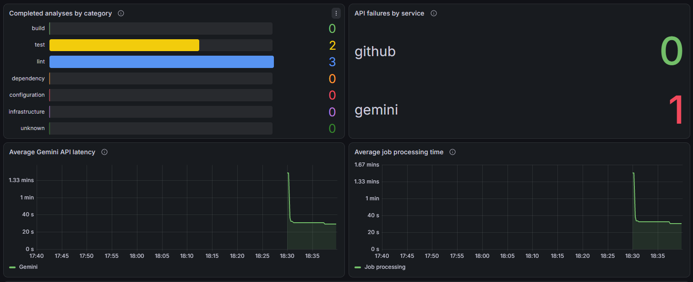
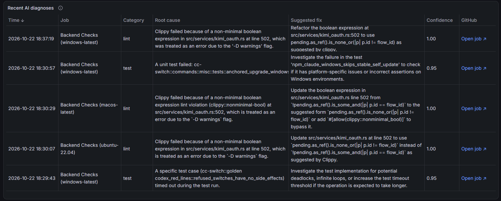
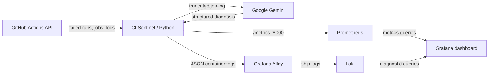

# CI Sentinel

**AI-powered diagnostics and observability for GitHub Actions failures.**

CI Sentinel watches failed GitHub Actions jobs, retrieves their logs, and uses Google Gemini to generate a structured diagnosis: **failure category, likely root cause, suggested fix, and model-reported confidence**. It also publishes Prometheus metrics and sends individual diagnostic reports to Loki, so both operational statistics and actionable failure reports are available in **one Grafana dashboard**.

Built as a small Python CLI and long-running monitoring service, with a five-container local Docker Compose stack. No custom frontend or database is required.




## Features

- **Discover CI failures:** list recent failed workflow runs and inspect their failed or timed-out jobs via the GitHub REST API.
- **Explain failures with Gemini:** classify each job as `build`, `test`, `lint`, `dependency`, `configuration`, `infrastructure`, or `unknown`; return a likely cause, suggested fix, and confidence score.
- **Two use cases:** run an analysis on demand from the CLI, or continuously poll a repository with `serve`.
- **Avoid duplicate work:** skip successfully analyzed jobs during the current monitoring process; retry jobs whose Gemini analysis failed.
- **Monitor performance:** export Prometheus counters and histograms for diagnoses, API errors, Gemini latency, and job processing time.
- **Investigate in Grafana:** view metrics and a searchable table of individual AI diagnoses stored in Loki, including direct links to the GitHub Actions jobs.
- **Automated checks:** GitHub Actions runs pytest, Ruff, and mypy on pushes and pull requests.

## Quick start: Docker Compose

**Requirements:** Docker Desktop (or Docker Engine with Compose), a [Google Gemini API key](https://aistudio.google.com/apikey), and access to a GitHub repository with GitHub Actions workflow runs. A GitHub token is strongly recommended for retrieving job logs and avoiding unauthenticated rate limits; for private repositories, it must have appropriate repository/Actions read access.

1. Clone this repository and open its root directory.
2. Create a local `.env` file from `.env.example`:

   ```powershell
   Copy-Item .env.example .env
   ```

   Edit `.env`:

   ```dotenv
   CI_SENTINEL_REPOSITORY=owner/repo
   GITHUB_TOKEN=your_github_token
   GEMINI_API_KEY=your_gemini_api_key
   ```

   Replace `owner/repo` with the repository you want to monitor. **Never commit `.env` or API keys.**

3. Start the stack:

   ```powershell
   docker compose up -d --build
   docker compose ps
   ```

4. Open the **[CI Sentinel dashboard](http://localhost:3000/d/ci-sentinel/ci-sentinel-observability)**. On a fresh Grafana installation, sign in with `admin` / `admin` and change the password when prompted. Both Prometheus and Loki data sources and the dashboard are provisioned automatically.

5. Scroll down to **Recent AI diagnoses** for individual reports. Each row contains the time, job, category, root cause, suggested fix, confidence, and a clickable **Open job** link (scroll horizontally if needed). If no failures are available or no jobs have been processed yet, the table and some charts may initially be empty.

**Other useful URLs:** [Prometheus targets](http://localhost:9090/targets) (check that `ci-sentinel` is **UP**). Only Grafana on `localhost:3000` and Prometheus on `localhost:9090` are published to the host. CI Sentinel's metrics port (`8000`) and Loki (`3100`) remain internal to Docker.

The supplied Compose configuration monitors the **most recent failed workflow run** and sleeps **120 seconds after each polling cycle**. A workflow run can contain several failed jobs; the limit is **runs, not diagnoses**. Change `--interval` or add `--limit` in `docker-compose.yml` to suit your usage.

### Everyday Docker commands

```powershell
docker compose ps                                  # Status
docker compose logs --tail=100 ci-sentinel         # Analysis reports and API errors
docker compose logs --tail=100 alloy loki          # Log shipping and storage diagnostics
docker compose up -d --build                       # Rebuild after source changes
docker compose down                                # Stop; preserve stored data
```

`docker compose down -v` additionally **deletes** the Prometheus, Loki, and Grafana data volumes. Use it only for a deliberate reset.

## Command-line usage (without Docker)

**Requirements:** Python 3.12+, GitHub access, and a Gemini API key for analysis.

Install locally from the project root:

```powershell
python -m venv .venv
.\.venv\Scripts\Activate.ps1
python -m pip install -e ".[dev]"
```

For a PowerShell session, set credentials:

```powershell
$env:GITHUB_TOKEN = gh auth token       # Requires GitHub CLI login; alternatively set your token directly
$env:GEMINI_API_KEY = "your-gemini-api-key"
```

Or set those environment variables using your operating system's preferred method. `GITHUB_TOKEN` is optional for some public metadata queries, but recommended for log access; `GEMINI_API_KEY` is needed by `analyze` and `serve`.

| Command | Purpose |
| --- | --- |
| `ci-sentinel list-failures owner/repo --limit 5` | Show the latest failed workflow runs and their URLs. |
| `ci-sentinel inspect-run owner/repo RUN_ID` | List failed or timed-out jobs in a run. |
| `ci-sentinel inspect-run owner/repo RUN_ID --logs` | Include shortened logs for each failed job. |
| `ci-sentinel inspect-run owner/repo RUN_ID --attempt 2` | Inspect a specific workflow attempt. |
| `ci-sentinel analyze owner/repo --limit 3` | Analyze failed jobs in up to three recent failed runs; print readable reports. |
| `ci-sentinel serve owner/repo --limit 3 --interval 120` | Continuously poll and export Prometheus metrics. |

`list-failures` accepts 1–100 runs. `analyze` and `serve` accept 1–5 runs, defaulting to **1** if `--limit` is omitted. Run `ci-sentinel --help` or `ci-sentinel <command> --help` for details.

A typical AI report looks like:

```json
{
  "category": "lint",
  "root_cause": "Clippy rejected a nonminimal boolean expression.",
  "suggested_fix": "Simplify the expression and rerun cargo clippy.",
  "confidence_score": 0.95
}
```

*Illustrative example; actual output is generated from the retrieved job log.*

**CLI vs dashboard:** `analyze` is a standalone, one-off command that prints its diagnoses to your terminal. `serve` produces structured JSON diagnostic events, which Grafana Alloy forwards to Loki **when running inside the provided Compose stack**. Running `serve` directly on the host exposes local metrics, but does not by itself install the Docker-based log collection pipeline.

## Architecture



**Processing flow:** fetch the latest failed workflow runs → find failed/timed-out jobs → download each job's log → keep the last 12,000 characters → ask Gemini for a Pydantic-validated diagnosis → record metrics and emit a structured report. Successfully processed `(run_id, attempt, job_id)` combinations are remembered in memory; Gemini failures are eligible for retry in subsequent polling cycles.

**Why separate metrics and logs?** Prometheus answers *how often failures occur and how the monitor performs*; Loki answers *which job failed, why, and what to fix*. Grafana makes both accessible from one UI. Alloy reads only CI Sentinel's container logs via Docker discovery.

### Repository layout

```text
src/ci_sentinel/
  cli.py                 CLI commands and polling loop
  github_client.py       Authenticated GitHub HTTP client
  github_actions.py      Failed-run/job retrieval and log truncation
  analyzer.py            Gemini integration and Pydantic report schema
  metrics.py             Prometheus instrumentation
  iso_datetime.py        Timestamp parsing
.github/workflows/ci.yml  Automated pytest, Ruff, and mypy checks
alloy/                     Grafana Alloy log collector config
loki/                      Loki local storage config
prometheus/                Prometheus scrape config
grafana/                   Data source and dashboard provisioning
tests/                     Mock-based Python unit tests
Dockerfile
docker-compose.yml
```

## Grafana dashboard

The dashboard is version-controlled in `grafana/dashboards/ci-sentinel.json` and loads automatically with Grafana provisioning. It includes five panels:

| Panel | What it shows |
| --- | --- |
| Completed analyses by category | Successful analyses grouped by Gemini's reported failure category. |
| API failures by service | Recorded GitHub and Gemini API errors; errors remain counted after successful retries. |
| Average Gemini API latency | Cumulative average time per analysis request, including SDK retries. |
| Average job processing time | Cumulative average time to retrieve and analyze a job. |
| Recent AI diagnoses | Loki-backed table with root causes, suggested fixes, confidence, and GitHub job links. |

**Analyses and request latencies:** The overview screenshot at the top of this README shows the four Prometheus panels in a normal monitoring session.

The first four panels show process-lifetime counters and cumulative averages; the chart time range does **not** turn those values into interval-specific rates. Prometheus scrapes every 15 seconds, and Grafana refreshes every 15 seconds. Prometheus retains scraped history across service restarts, while CI Sentinel's in-process counters reset.

For advanced filtering, open **Grafana → Explore → Loki** and run:

```logql
{app="ci-sentinel"} | json event="event" | event="ci_diagnostic"
```

The dashboard's **Recent AI diagnoses** table is the easiest way to read reports; Explore is useful for searching individual JSON fields and inspecting the complete raw records.

## Testing and CI

Install the development dependencies with `python -m pip install -e ".[dev]"`, then run:

```powershell
python -m pytest
python -m ruff check .
python -m mypy
```

The GitHub Actions workflow in `.github/workflows/ci.yml` runs these checks on **every push and pull request** using Python 3.12. The tests mock external GitHub and Gemini requests; they do not require credentials or a running Docker stack.

## Troubleshooting

- **Gemini HTTP 503:** the service can be temporarily unavailable or overloaded. CI Sentinel records the error and retries failed jobs on subsequent polling cycles; previously successful jobs are skipped.
- **Empty Grafana panels:** check `docker compose ps`, then [Prometheus targets](http://localhost:9090/targets). Confirm you have failed runs in the selected repository and that the dashboard time range includes the processed jobs.
- **No diagnoses in the table:** check `docker compose logs --tail=100 ci-sentinel alloy loki`, then select the Loki data source in Grafana Explore. Structured reports are emitted by `serve`, not one-off `analyze` runs.
- **GitHub 401, 403, or 404:** confirm the repository identifier, token validity, rate limits, and repository/Actions permissions.
- **The same job is analyzed again after restarting:** deduplication is stored in the process's memory and resets on restart. Previously collected Loki reports remain in Loki storage.
- **Ports 3000 or 9090 already in use:** stop the conflicting service or change the corresponding host port mapping in `docker-compose.yml`.

## Limitations and security

This is a **local-development/portfolio MVP**, not a hardened multi-tenant production service.

- HTTP 503 and other external service errors may temporarily prevent analysis; the application handles Gemini failures per job but does not guarantee eventual success.
- Only one repository is monitored per `serve` instance, and only the most recent 1–5 failed workflow runs are examined. GitHub pagination is not implemented for job lists; at most the first 100 jobs of a run are fetched.
- Processing is sequential. Polling, deduplication state, and Prometheus counters are in memory; state does not survive restarts.
- Only the last 12,000 characters of each job log are sent for diagnosis. Relevant context may be lost, and an LLM's explanation or confidence score may be incorrect. The tool recommends fixes but does **not** modify repositories or open pull requests.
- **CI logs can contain secrets.** The tool does not automatically redact logs before sending them to Google Gemini; diagnostic text stored in Loki may also reproduce sensitive information. Use repositories whose logs you are authorized to share with that service.
- The bundled Compose stack uses Grafana's initial admin credentials and unauthenticated local Loki; it should **not** be exposed publicly. Change the Grafana password. Alloy's Docker socket access is highly privileged **even when mounted read-only**; run this setup only on a trusted machine.

## Possible next improvements

1. **Persistent job state** and a small analysis-history store to avoid repeat work after restarts.
2. **Rate-limit-aware backoff** and better handling of extended Gemini or GitHub outages.
3. **Multiple repositories, pagination, and concurrency** for larger workloads.
4. **Sensitive-data redaction** before sending logs to Gemini or storing diagnoses.
5. **Grafana alerting and notifications** for repeated failures or service degradation.
6. **More targeted log extraction** and links to relevant error lines, rather than fixed-length tail truncation.

---

**Tech stack:** Python 3.12 · GitHub REST API · Google Gemini · Pydantic · pytest · Ruff · mypy · Docker Compose · Prometheus · Grafana · Loki · Grafana Alloy · GitHub Actions.
